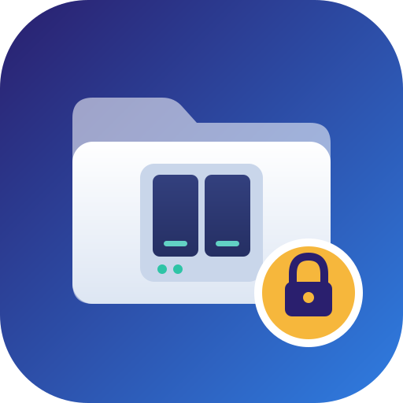
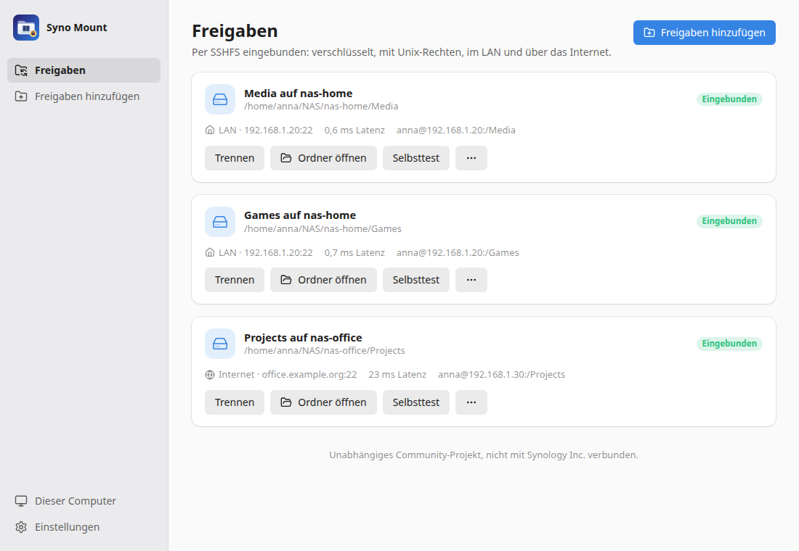
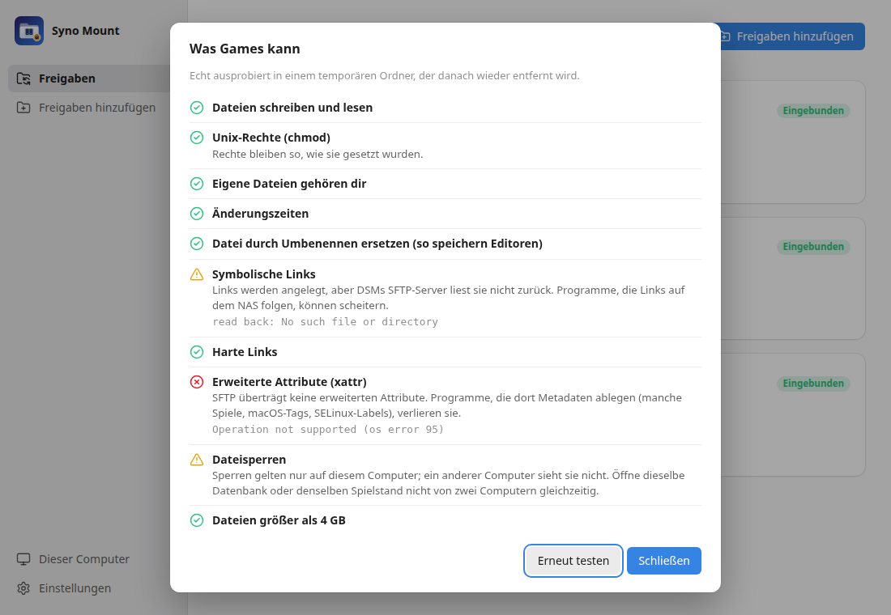

# Syno Mount

<p align="center">
  
</p>

> Deutsche Fassung. Englisches Original: [README.md](README.md)

**Syno Mount** bindet die Freigaben eines **Synology-NAS** unter **Linux** per **SSHFS** ein, eingerichtet von einem geführten Assistenten. Die Ordner sind unterwegs verschlüsselt, behalten Unix-Rechte und Zeitstempel, funktionieren im LAN und über das Internet, werden bei der Anmeldung eingebunden und kommen nach Standby oder Netzwechsel zurück.

Gemacht für alle, denen SMB und WebDAV nicht reichen: Programme und Spiele, die auf Netzlaufwerken scheitern, weil Metadaten fehlen, und WebDAV, das bei großen Dateien aussteigt. Ein **Selbsttest** zeigt für jeden Ordner, was er kann, bevor du dich darauf verlässt.

> **Stand: 0.5, erste Veröffentlichung.** Getestet mit Virtual DSM 7.2.2, mit einem Administrator- und einem normalen Konto. Downloads: [Releases](https://github.com/SoulInfernoDE/syno-mount/releases). Siehe [Roadmap](ROADMAP.de.md).
>
> Syno Mount ist ein unabhängiges Community-Projekt. Es ist nicht mit Synology Inc. verbunden und wird von Synology weder unterstützt noch empfohlen. „Synology“ und „DSM“ sind Marken der Synology Inc.

<p align="center">
  
</p>

## Was es tut

- **Findet das NAS** im Netzwerk (Bonjour und die Suche von Synology Assistant) oder über die Adresse.
- **Meldet sich einmal bei DSM an** (mit zweistufiger Bestätigung), prüft, ob **SFTP** und der **Benutzer-Home-Dienst** an sind, und schaltet sie nach Rückfrage ein. Konten, die DSM nicht nutzen dürfen, gehen nur über SFTP.
- **Vertraut dem NAS bewusst:** zeigt den SHA-256-Fingerabdruck seines SSH-Host-Keys und hält ihn in den eigenen `known_hosts` der App fest. Ein geänderter Schlüssel stoppt jeden Mount.
- **Erzeugt einen ed25519-Schlüssel** für diesen Computer und installiert ihn per SFTP auf dem NAS, mit den Rechten, die sshd verlangt. Es wird kein Passwort gespeichert, weder das von DSM noch das für SSH.
- **Bindet jeden Ordner** über einen eigenen systemd-User-Dienst ein: auf Wunsch bei der Anmeldung, mit `reconnect`, Keep-alives, der schnellsten Verschlüsselung für den Prozessor des NAS und parallelen Verbindungen. Eigene Dateien gehören dir (Besitzer-Zuordnung).
- **Hält Ordner eingebunden:** Ein kleiner Agent bemerkt Standby und Netzwechsel, löst hängende Mounts, bindet neu ein und wechselt zwischen LAN- und Internet-Adresse.
- **Selbsttest und Geschwindigkeitstest** pro Ordner, eine Statusseite mit Weg und Latenz, der genaue `sshfs`-Befehl zum Nachlesen und **Rückgängig** für alles, auch für den Schlüssel auf dem NAS.

<p align="center">
  
</p>

## Was SSHFS kann und was nicht

SSHFS reicht mehr durch als SMB oder WebDAV, bleibt aber ein Netzwerk-Dateisystem. Der Selbsttest probiert jeden Punkt echt aus.

| Funktioniert                                                                                                              | Eingeschränkt                                                                                                        | Funktioniert nicht           |
| ------------------------------------------------------------------------------------------------------------------------- | -------------------------------------------------------------------------------------------------------------------- | ---------------------------- |
| Unix-Rechte (in Ordnern ohne ACL, siehe unten), Besitzer, Zeiten, Umbenennen über Dateien, harte Links, Dateien über 4 GB | Symbolische Links (werden angelegt, aber DSMs SFTP-Server liest sie nicht zurück), Sperren (nur auf diesem Computer) | Erweiterte Attribute (xattr) |

Für Spiele, Steam-Bibliotheken und Wine-Präfixe, die eine echte Platte brauchen, ist ein **iSCSI**-Backend geplant, siehe [Roadmap](ROADMAP.de.md).

### Unix-Rechte unter DSM

DSM legt Freigaben mit **Windows-ACLs** an. In solchen Ordnern ignoriert DSM `chmod`: Jede Datei zeigt `777`. Ein Ordner **ohne ACL** behält über SSHFS echte Unix-Rechte. Ein Administrator kann die ACL eines Ordners auf dem NAS entfernen:

```sh
sudo synoacltool -del /volume1/<freigabe>/<ordner>
```

Danach gehört der Ordner seinem Besitzer mit den Rechten, die er hat; setze sie wie gewohnt mit `chmod`. Mach das nur für Ordner, die ein einziges Konto nutzt: Die Rechte-Einstellungen von DSM gelten für sie dann nicht mehr.

## Installation

Syno Mount braucht `sshfs` (3.x, am besten 3.7 oder neuer) und FUSE 3 aus der Distribution. Die Pakete ziehen beides nach; für das AppImage installierst du es selbst:

```bash
sudo apt install sshfs
```

Dann das Paket für dein System aus den [Releases](https://github.com/SoulInfernoDE/syno-mount/releases) installieren: `.deb` (Debian, Ubuntu, Linux Mint), `.rpm` (Fedora, openSUSE) oder `.AppImage`, jeweils für x86_64 und arm64.

## So funktioniert es

| Was                                            | Wo                                            |
| ---------------------------------------------- | --------------------------------------------- |
| Schlüssel, `known_hosts`, Besitzer-Zuordnungen | `~/.local/share/syno-mount`                   |
| Liste der Ordner und NAS                       | `~/.config/syno-mount`                        |
| Ein Dienst pro Ordner, dazu der Agent          | `~/.config/systemd/user/syno-mount-*.service` |
| Welche Adresse ein Ordner gerade nutzt         | `~/.local/state/syno-mount`                   |

Dein eigenes `~/.ssh` bleibt unberührt. Jeder Dienst startet `syno-mount run-mount <id>`, das die LAN- oder Internet-Adresse wählt und dann `sshfs` startet; die App zeigt den vollständigen Befehl. Mehr in [docs/architecture.de.md](docs/architecture.de.md).

**Über das Internet** braucht das NAS einen weitergeleiteten SSH-Port (besser nicht 22) oder ein VPN. QuickConnect leitet kein SSH weiter. Trage DDNS-Name und Port als Internet-Adresse eines Ordners ein.

## Bauen

Voraussetzungen: Rust 1.99+, Node.js 24+, `sshfs` und die [Systemabhängigkeiten von Tauri 2](https://tauri.app/start/prerequisites/).

```bash
npm ci
npm run app:dev
```

`npm run dev` und `http://localhost:5175/?mock` zeigen die Oberfläche im Browser mit Beispieldaten. Tests: `cargo test`, `npm run check`. Die ganze Kette gegen ein Test-NAS: [docs/test-environment.de.md](docs/test-environment.de.md).

## Lizenz

GPL-3.0-or-later. Der DSM-Client und die Netzwerksuche stammen aus [Syno Companion](https://github.com/SoulInfernoDE/synology-companion-app), wohin Syno Mount später umzieht.
