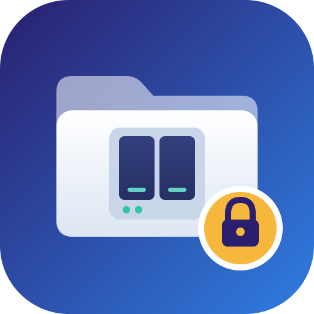
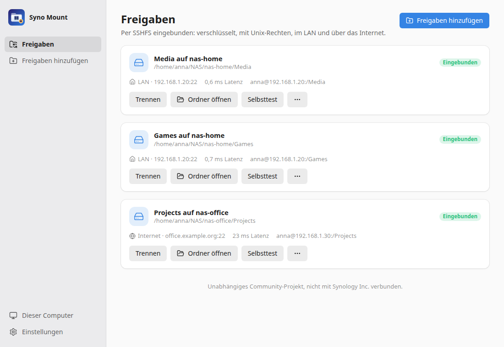
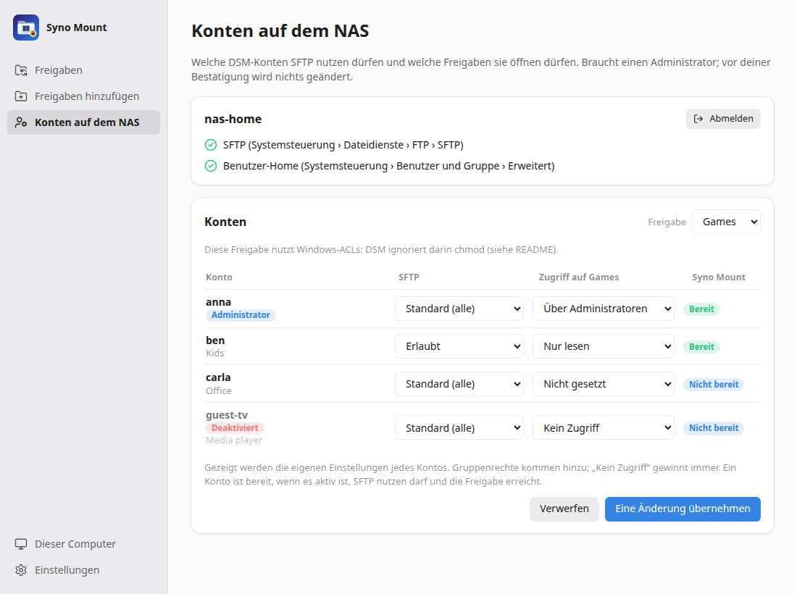
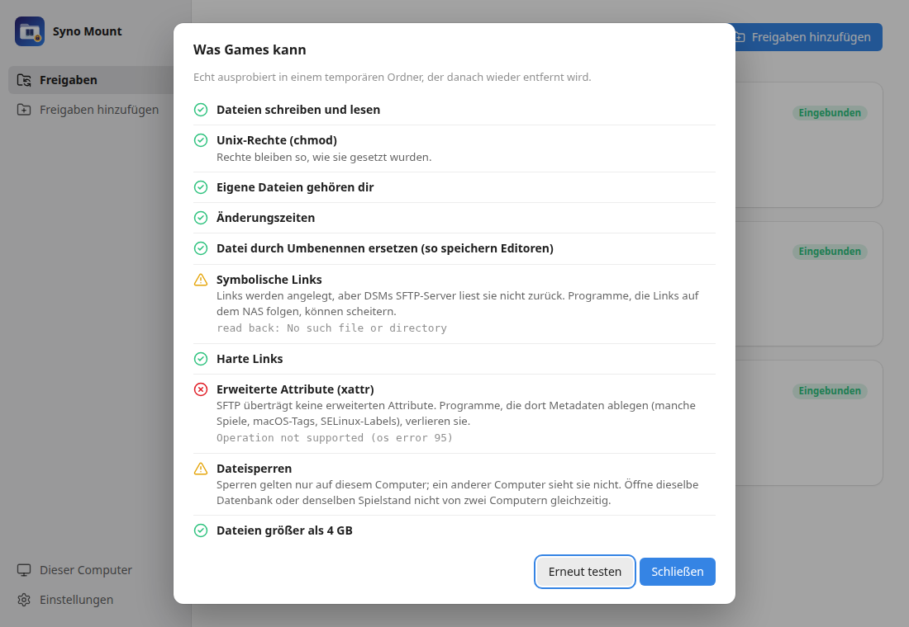

# Syno Mount

<p align="center">
  
</p>

> Deutsche Fassung. Englisches Original: [README.md](README.md)

**Syno Mount** bindet die Freigaben eines **Synology-NAS** unter **Linux** (per **SSHFS**) und **Windows** (als Netzlaufwerke über **rclone** und **WinFsp**) ein, eingerichtet von einem geführten Assistenten. Die Ordner sind unterwegs verschlüsselt, behalten Unix-Rechte und Zeitstempel, funktionieren im LAN und über das Internet, werden bei der Anmeldung eingebunden und kommen nach Standby oder Netzwechsel zurück.

Gemacht für alle, denen SMB und WebDAV nicht reichen: Programme und Spiele, die auf Netzlaufwerken scheitern, weil Metadaten fehlen, und WebDAV, das bei großen Dateien aussteigt. Ein **Selbsttest** zeigt für jeden Ordner, was er kann, bevor du dich darauf verlässt.

> **Stand: 0.6.** Linux ist mit Virtual DSM 7.2.2 getestet, mit einem Administrator- und einem normalen Konto, ebenso der Adminbereich. **Windows ist neu:** Einbinden, Agent und Selbsttest sind auf einer Windows-11-VM getestet; das Fenster selbst, Autostart und Standby noch nicht. Downloads: [Releases](https://github.com/SoulInfernoDE/syno-mount/releases). Siehe [Roadmap](ROADMAP.de.md).
>
> Syno Mount ist ein unabhängiges Community-Projekt. Es ist nicht mit Synology Inc. verbunden und wird von Synology weder unterstützt noch empfohlen. „Synology“ und „DSM“ sind Marken der Synology Inc.

<p align="center">
  
</p>

## Was es tut

- **Findet das NAS** im Netzwerk (Bonjour und die Suche von Synology Assistant) oder über die Adresse.
- **Meldet sich einmal bei DSM an** (mit zweistufiger Bestätigung), prüft, ob **SFTP** und der **Benutzer-Home-Dienst** an sind, und schaltet sie nach Rückfrage ein. Konten, die DSM nicht nutzen dürfen, gehen nur über SFTP.
- **Vertraut dem NAS bewusst:** zeigt den SHA-256-Fingerabdruck seines SSH-Host-Keys und hält ihn in den eigenen `known_hosts` der App fest. Ein geänderter Schlüssel stoppt jeden Mount.
- **Erzeugt einen ed25519-Schlüssel** für diesen Computer und installiert ihn per SFTP auf dem NAS, mit den Rechten, die sshd verlangt. Es wird kein Passwort gespeichert, weder das von DSM noch das für SSH.
- **Bindet jeden Ordner ein**, auf Wunsch bei der Anmeldung, mit Keep-alives, der schnellsten Verschlüsselung für den Prozessor des NAS und parallelen Verbindungen. Unter **Linux** als Ordner über `sshfs`, mit einem eigenen systemd-User-Dienst pro Ordner, und eigene Dateien gehören dir (Besitzer-Zuordnung). Unter **Windows** als Netzlaufwerk oder Ordner über `rclone`.
- **Hält Ordner eingebunden:** Ein kleiner Agent bemerkt Standby und Netzwechsel, löst hängende Mounts, bindet neu ein und wechselt zwischen LAN- und Internet-Adresse.
- **Selbsttest und Geschwindigkeitstest** pro Ordner, eine Statusseite mit Weg und Latenz, der genaue `sshfs`- oder `rclone`-Befehl zum Nachlesen und **Rückgängig** für alles, auch für den Schlüssel auf dem NAS.
- **Konten auf dem NAS** (Adminbereich): welche DSM-Konten SFTP nutzen dürfen und welche Freigaben sie öffnen dürfen (kein Zugriff, nur lesen, lesen und schreiben), mit einer Prüfung „bereit für Syno Mount“ pro Konto. In DSM ändert sich nichts, bevor du die Liste der Änderungen bestätigst.

<p align="center">
  
</p>

<p align="center">
  
</p>

## Was ein eingebundener Ordner kann und was nicht

Beide Wege reichen mehr durch als SMB oder WebDAV, bleiben aber Netzwerk-Dateisysteme. Der Selbsttest probiert jeden Punkt echt aus.

**Linux (SSHFS):**

| Funktioniert                                                                                                              | Eingeschränkt                                                                                                        | Funktioniert nicht           |
| ------------------------------------------------------------------------------------------------------------------------- | -------------------------------------------------------------------------------------------------------------------- | ---------------------------- |
| Unix-Rechte (in Ordnern ohne ACL, siehe unten), Besitzer, Zeiten, Umbenennen über Dateien, harte Links, Dateien über 4 GB | Symbolische Links (werden angelegt, aber DSMs SFTP-Server liest sie nicht zurück), Sperren (nur auf diesem Computer) | Erweiterte Attribute (xattr) |

**Windows (rclone):** Lesen, Schreiben, Zeiten und Umbenennen funktionieren; Sperren gelten nur auf diesem Computer. Windows kennt über SFTP keine Unix-Rechte und keine Besitzer-Zuordnung, Links werden nicht unterstützt.

Für Spiele, Steam-Bibliotheken und Wine-Präfixe, die eine echte Platte brauchen, ist ein **iSCSI**-Backend geplant, siehe [Roadmap](ROADMAP.de.md).

### Unix-Rechte unter DSM

DSM legt Freigaben mit **Windows-ACLs** an. In solchen Ordnern ignoriert DSM `chmod`: Jede Datei zeigt `777`. Ein Ordner **ohne ACL** behält über SSHFS echte Unix-Rechte. Ein Administrator kann die ACL eines Ordners auf dem NAS entfernen:

```sh
sudo synoacltool -del /volume1/<freigabe>/<ordner>
```

Danach gehört der Ordner seinem Besitzer mit den Rechten, die er hat; setze sie wie gewohnt mit `chmod`. Mach das nur für Ordner, die ein einziges Konto nutzt: Die Rechte-Einstellungen von DSM gelten für sie dann nicht mehr.

## Windows

Unter Windows wird jeder Ordner ein **Netzlaufwerk** (ab `Z:` abwärts) oder ein Ordner. [rclone](https://rclone.org) spricht SFTP, [WinFsp](https://winfsp.dev) stellt das Laufwerk bereit; beides ist freie Software (siehe [Installation](#installation)).

Assistent, Schlüssel, festgehaltener Host-Key und Adminbereich funktionieren wie unter Linux. Ein kleiner Agent (`syno-mount.exe agent`, bei der Anmeldung über den `Run`-Schlüssel des Nutzers gestartet) startet pro Ordner ein rclone, startet es neu, wenn es endet oder hängt, und wechselt zwischen LAN- und Internet-Adresse.

Warum nicht SSHFS-Win: Die letzte Version stammt von 2021, rclone und WinFsp werden dagegen gepflegt.

## Installation

Die Downloads für beide Systeme liegen bei den [Releases](https://github.com/SoulInfernoDE/syno-mount/releases); prüfen mit `sha256sum -c SHA256SUMS.txt`.

### Linux

Installiere das Paket für dein System: `.deb` (Debian, Ubuntu, Linux Mint), `.rpm` (Fedora, openSUSE) oder `.AppImage`, jeweils für x86_64 und arm64. Syno Mount braucht `sshfs` (3.x, am besten 3.7 oder neuer) und FUSE 3 aus der Distribution. Die Pakete ziehen beides nach; für das AppImage installierst du es selbst:

```bash
sudo apt install sshfs
```

### Windows

Windows 10 oder 11 auf x64 (getestet unter Windows 11). Zuerst WinFsp und rclone installieren:

```powershell
winget install -e --id WinFsp.WinFsp
winget install -e --id Rclone.Rclone
```

Dann `syno-mount-<version>-windows-x64-setup.exe` ausführen (installiert für dein Konto, ohne Administratorrechte) oder die `.msi`. Die Installer sind noch nicht signiert, SmartScreen kann deshalb warnen: „Weitere Informationen“, dann „Trotzdem ausführen“. Die Seite **System** der App zeigt, ob rclone und WinFsp gefunden wurden.

## So funktioniert es

| Was                                            | Linux                                         | Windows                                              |
| ---------------------------------------------- | --------------------------------------------- | ---------------------------------------------------- |
| Schlüssel, `known_hosts`, Besitzer-Zuordnungen | `~/.local/share/syno-mount`                   | `%LOCALAPPDATA%\syno-mount`                          |
| Liste der Ordner und NAS                       | `~/.config/syno-mount`                        | `%APPDATA%\syno-mount`                               |
| Einbinden und Agent                            | `~/.config/systemd/user/syno-mount-*.service` | `syno-mount.exe agent` aus dem `Run`-Schlüssel       |
| Welche Adresse ein Ordner gerade nutzt         | `~/.local/state/syno-mount`                   | `%LOCALAPPDATA%\syno-mount` (mit rclone-Protokollen) |

Dein eigenes `~/.ssh` bleibt unberührt. Unter Linux startet jeder Dienst `syno-mount run-mount <id>`, das die LAN- oder Internet-Adresse wählt und dann `sshfs` startet; unter Windows macht der Agent dasselbe mit `rclone mount`. Die App zeigt den vollständigen Befehl. Mehr in [docs/architecture.de.md](docs/architecture.de.md).

**Über das Internet** braucht das NAS einen weitergeleiteten SSH-Port (besser nicht 22) oder ein VPN. QuickConnect leitet kein SSH weiter. Trage DDNS-Name und Port als Internet-Adresse eines Ordners ein.

## Bauen

Voraussetzungen: Rust 1.99+, Node.js 24+ und die [Systemabhängigkeiten von Tauri 2](https://tauri.app/start/prerequisites/); zum Ausführen `sshfs` unter Linux, WinFsp und rclone unter Windows. Windows-Pakete werden unter Windows gebaut (das macht die CI); Cross-Kompilieren von Linux aus funktioniert nicht.

```bash
npm ci
npm run app:dev
```

`npm run dev` und `http://localhost:5175/?mock` zeigen die Oberfläche im Browser mit Beispieldaten. Tests: `cargo test`, `npm run check`. Die ganze Kette gegen ein Test-NAS: [docs/test-environment.de.md](docs/test-environment.de.md).

## Lizenz

GPL-3.0-or-later. Der DSM-Client und die Netzwerksuche stammen aus [Syno Companion](https://github.com/SoulInfernoDE/synology-companion-app), wohin Syno Mount später umzieht.
