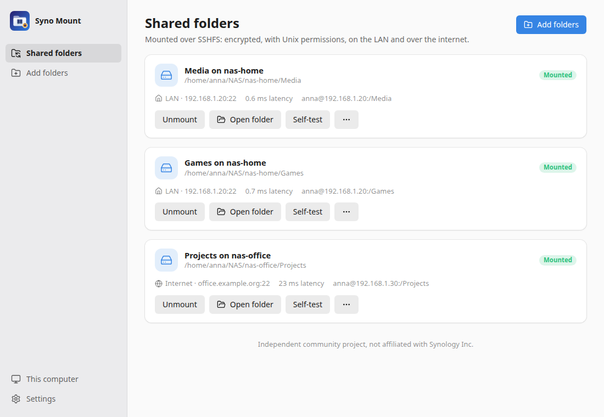
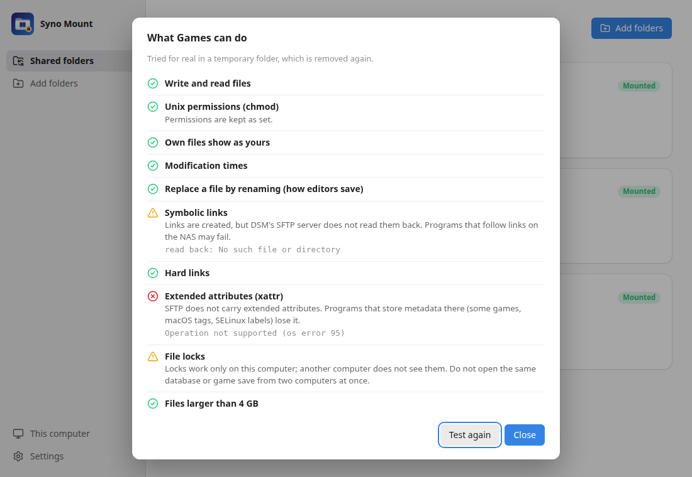

# Syno Mount

<p align="center">
  
</p>

> English original. German version: [README.de.md](README.de.md)

**Syno Mount** mounts the shared folders of a **Synology NAS** on **Linux** over **SSHFS**, set up by a guided assistant. Folders are encrypted on the way, keep Unix permissions and timestamps, work on the LAN and over the internet, mount at login and come back after suspend or a network change.

It is made for people who found SMB and WebDAV wanting: programs and games that fail on network drives because metadata is missing, WebDAV that drops large files. A **self-test** shows for every folder what it can do before you rely on it.

> **Status: 0.5, first release.** Tested against Virtual DSM 7.2.2 with an administrator and a regular account. Downloads: [releases](https://github.com/SoulInfernoDE/syno-mount/releases). See the [roadmap](ROADMAP.md).
>
> Syno Mount is an independent community project. It is not affiliated with, endorsed by or supported by Synology Inc. "Synology" and "DSM" are trademarks of Synology Inc.

<p align="center">
  
</p>

## What it does

- **Finds the NAS** on the network (Bonjour and Synology Assistant's own search) or by address.
- **Signs in to DSM once** (with two-step verification) to check that **SFTP** and the **user home service** are on, and switches them on after asking. Accounts that may not use DSM go by SFTP alone.
- **Trusts the NAS deliberately:** shows the SHA-256 fingerprint of its SSH host key and pins it in the app's own `known_hosts`. A changed key stops every mount.
- **Creates an ed25519 key** for this computer and installs it on the NAS over SFTP, with the permissions sshd insists on. No password is stored, neither DSM's nor the SSH one.
- **Mounts each folder** with one systemd user service: at login if you like, `reconnect`, keep-alives, the fastest cipher for the NAS's processor, parallel connections. Own files show as yours (owner mapping).
- **Keeps folders mounted:** a small agent notices suspend and network changes, releases hanging mounts and mounts again, and switches between the LAN and the internet address.
- **Self-test and speed test** per folder, a status page with route and latency, the exact `sshfs` command to read, and **undo** of everything, including the key on the NAS.

<p align="center">
  
</p>

## What SSHFS can and cannot do

SSHFS passes on more than SMB or WebDAV, but it is still a network file system. The self-test tries each point for real.

| Works                                                                                                                  | Limited                                                                                                | Does not work               |
| ---------------------------------------------------------------------------------------------------------------------- | ------------------------------------------------------------------------------------------------------ | --------------------------- |
| Unix permissions (in folders without ACL, see below), owner, times, renaming over files, hard links, files beyond 4 GB | Symbolic links (created, but DSM's SFTP server does not read them back), locks (only on this computer) | Extended attributes (xattr) |

For games, Steam libraries and Wine prefixes that need a real disk, an **iSCSI** backend is planned; see the [roadmap](ROADMAP.md).

### Unix permissions on DSM

DSM creates shared folders with **Windows ACLs**. In such folders DSM ignores `chmod`: every file shows `777`. A folder **without ACL** keeps real Unix permissions over SSHFS. An administrator can remove the ACL of a folder on the NAS:

```sh
sudo synoacltool -del /volume1/<share>/<folder>
```

Afterwards the folder belongs to its owner with the mode it has; set it with `chmod` as usual. Do this only for folders that one account uses: DSM's permission settings no longer apply to them.

## Install

Syno Mount needs `sshfs` (3.x, best 3.7 or newer) and FUSE 3 from the distribution. The packages pull them in; for the AppImage install them yourself:

```bash
sudo apt install sshfs
```

Then install the package for your system from the [releases](https://github.com/SoulInfernoDE/syno-mount/releases): `.deb` (Debian, Ubuntu, Linux Mint), `.rpm` (Fedora, openSUSE) or `.AppImage`, each for x86_64 and arm64.

## How it works

| What                                   | Where                                         |
| -------------------------------------- | --------------------------------------------- |
| Keys, `known_hosts`, owner maps        | `~/.local/share/syno-mount`                   |
| List of folders and NAS                | `~/.config/syno-mount`                        |
| One service per folder, plus the agent | `~/.config/systemd/user/syno-mount-*.service` |
| Which address a folder uses            | `~/.local/state/syno-mount`                   |

Your own `~/.ssh` stays untouched. Each service runs `syno-mount run-mount <id>`, which picks the LAN or internet address and then runs `sshfs`; the app shows the full command. More in [docs/architecture.md](docs/architecture.md).

**Over the internet** the NAS needs a forwarded SSH port (better not 22) or a VPN. QuickConnect does not carry SSH. Enter the DDNS name and port as the internet address of a folder.

## Build

Requirements: Rust 1.99+, Node.js 24+, `sshfs`, and the [Tauri 2 system dependencies](https://tauri.app/start/prerequisites/).

```bash
npm ci
npm run app:dev
```

`npm run dev` and `http://localhost:5175/?mock` show the interface in the browser with sample data. Tests: `cargo test`, `npm run check`. The whole chain against a test NAS: [docs/test-environment.md](docs/test-environment.md).

## Licence

GPL-3.0-or-later. The DSM client and the network search come from [Syno Companion](https://github.com/SoulInfernoDE/synology-companion-app), where Syno Mount will move later.
