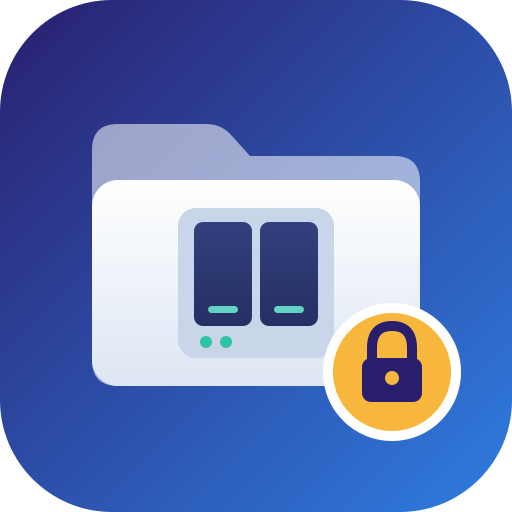
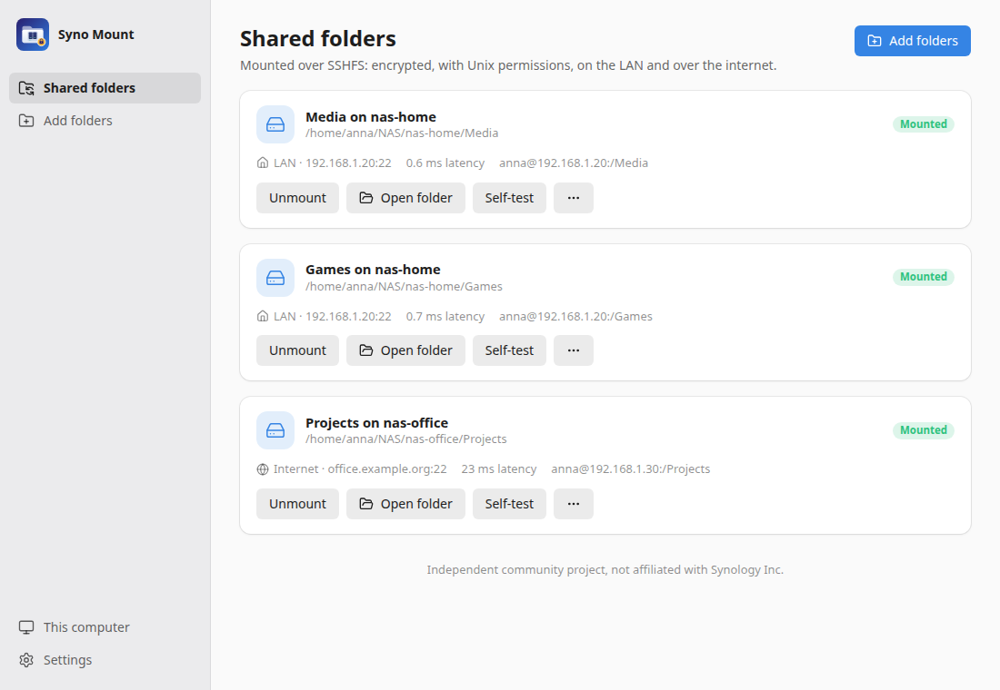
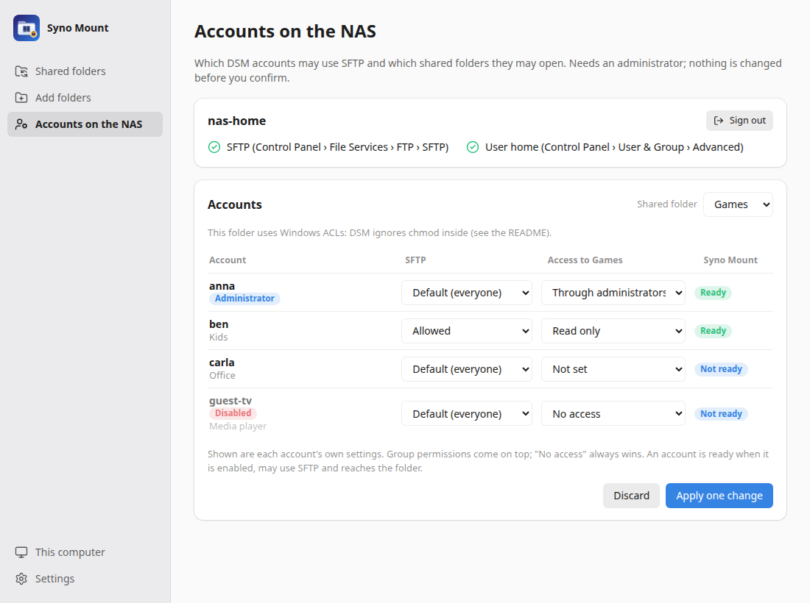
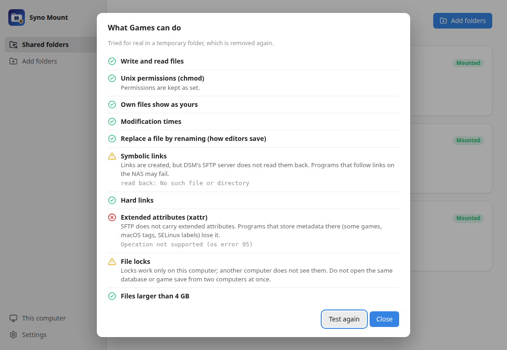

# Syno Mount

<p align="center">
  
</p>

> English original. German version: [README.de.md](README.de.md)

**Syno Mount** mounts the shared folders of a **Synology NAS** on **Linux** (over **SSHFS**) and **Windows** (as network drives through **rclone** and **WinFsp**), set up by a guided assistant. Folders are encrypted on the way, keep Unix permissions and timestamps, work on the LAN and over the internet, mount at login and come back after suspend or a network change.

It is made for people who found SMB and WebDAV wanting: programs and games that fail on network drives because metadata is missing, WebDAV that drops large files. A **self-test** shows for every folder what it can do before you rely on it.

> **Status: 0.6.** Linux is tested against Virtual DSM 7.2.2 with an administrator and a regular account; the administrator area as well. **Windows is new:** mounting, the agent and the self-test are tested on a Windows 11 VM; the window itself, autostart and suspend not yet. Downloads: [releases](https://github.com/SoulInfernoDE/syno-mount/releases). See the [roadmap](ROADMAP.md).
>
> Syno Mount is an independent community project. It is not affiliated with, endorsed by or supported by Synology Inc. "Synology" and "DSM" are trademarks of Synology Inc.

<p align="center">
  
</p>

## What it does

- **Finds the NAS** on the network (Bonjour and Synology Assistant's own search) or by address.
- **Signs in to DSM once** (with two-step verification) to check that **SFTP** and the **user home service** are on, and switches them on after asking. Accounts that may not use DSM go by SFTP alone.
- **Trusts the NAS deliberately:** shows the SHA-256 fingerprint of its SSH host key and pins it in the app's own `known_hosts`. A changed key stops every mount.
- **Creates an ed25519 key** for this computer and installs it on the NAS over SFTP, with the permissions sshd insists on. No password is stored, neither DSM's nor the SSH one.
- **Mounts each folder** at login if you like, with keep-alives, the fastest cipher for the NAS's processor and parallel connections. On **Linux** as a folder through `sshfs`, one systemd user service each, and your own files show as yours (owner mapping). On **Windows** as a network drive or folder through `rclone`.
- **Keeps folders mounted:** a small agent notices suspend and network changes, releases hanging mounts and mounts again, and switches between the LAN and the internet address.
- **Self-test and speed test** per folder, a status page with route, latency and whether the name of the NAS is looked up with encrypted DNS, the exact `sshfs` or `rclone` command to read, and **undo** of everything, including the key on the NAS.
- **Accounts on the NAS** (administrator area): which DSM accounts may use SFTP and which shared folders they may open (no access, read only, read and write), with a "ready for Syno Mount" check per account. A view by account sets one account's access to every folder and previews what it will see over SFTP, group permissions included. Nothing changes in DSM before you confirm the list of changes.

<p align="center">
  
</p>

<p align="center">
  
</p>

## What a mount can and cannot do

Both ways pass on more than SMB or WebDAV, but they are still network file systems. The self-test tries each point for real.

**Linux (SSHFS):**

| Works                                                                                                                  | Limited                                                                                                | Does not work               |
| ---------------------------------------------------------------------------------------------------------------------- | ------------------------------------------------------------------------------------------------------ | --------------------------- |
| Unix permissions (in folders without ACL, see below), owner, times, renaming over files, hard links, files beyond 4 GB | Symbolic links (created, but DSM's SFTP server does not read them back), locks (only on this computer) | Extended attributes (xattr) |

**Windows (rclone):** reading, writing, times and renaming work; locks hold only on this computer. Windows has no Unix permissions or owner mapping over SFTP, and links are not supported.

For games, Steam libraries and Wine prefixes that need a real disk, an **iSCSI** backend is planned; see the [roadmap](ROADMAP.md).

### Unix permissions on DSM

DSM creates shared folders with **Windows ACLs**. In such folders DSM ignores `chmod`: every file shows `777`. A folder **without ACL** keeps real Unix permissions over SSHFS. An administrator can remove the ACL of a folder on the NAS:

```sh
sudo synoacltool -del /volume1/<share>/<folder>
```

Afterwards the folder belongs to its owner with the mode it has; set it with `chmod` as usual. Do this only for folders that one account uses: DSM's permission settings no longer apply to them.

## Windows

On Windows each folder becomes a **network drive** (from `Z:` down) or a folder. [rclone](https://rclone.org) speaks SFTP and [WinFsp](https://winfsp.dev) provides the drive; both are free software (see [Install](#install)).

The assistant, the key, the pinned host key and the administrator area work as on Linux. A small agent (`syno-mount.exe agent`, started at sign-in through the user's `Run` key) starts one rclone per folder, restarts it when it ends or hangs, and moves between the LAN and the internet address.

Why not SSHFS-Win: its last release is from 2021, while rclone and WinFsp are maintained.

## Install

Downloads for both systems are on the [releases](https://github.com/SoulInfernoDE/syno-mount/releases) page; check them with `sha256sum -c SHA256SUMS.txt`.

### Linux

Install the package for your system: `.deb` (Debian, Ubuntu, Linux Mint), `.rpm` (Fedora, openSUSE) or `.AppImage`, each for x86_64 and arm64. Syno Mount needs `sshfs` (3.x, best 3.7 or newer) and FUSE 3 from the distribution. The packages pull them in; for the AppImage install them yourself:

```bash
sudo apt install sshfs
```

### Windows

Windows 10 or 11 on x64 (tested on Windows 11). First install WinFsp and rclone:

```powershell
winget install -e --id WinFsp.WinFsp
winget install -e --id Rclone.Rclone
```

Then run `syno-mount-<version>-windows-x64-setup.exe` (installs for your account, no administrator rights) or the `.msi`. The installers are not signed yet, so SmartScreen may warn: "More info", then "Run anyway". The **System** page of the app shows whether rclone and WinFsp were found.

## How it works

| What                            | Linux                                         | Windows                                        |
| ------------------------------- | --------------------------------------------- | ---------------------------------------------- |
| Keys, `known_hosts`, owner maps | `~/.local/share/syno-mount`                   | `%LOCALAPPDATA%\syno-mount`                    |
| List of folders and NAS         | `~/.config/syno-mount`                        | `%APPDATA%\syno-mount`                         |
| Mounting and the agent          | `~/.config/systemd/user/syno-mount-*.service` | `syno-mount.exe agent` from the `Run` key      |
| Which address a folder uses     | `~/.local/state/syno-mount`                   | `%LOCALAPPDATA%\syno-mount` (with rclone logs) |

Your own `~/.ssh` stays untouched. On Linux each service runs `syno-mount run-mount <id>`, which picks the LAN or internet address and then runs `sshfs`; on Windows the agent does the same with `rclone mount`. The app shows the full command. More in [docs/architecture.md](docs/architecture.md).

**Over the internet** the NAS needs a forwarded SSH port (better not 22), a VPN, or (Linux, new) a **reverse proxy on port 443**: tick "Through HTTPS" next to the internet address, and SSH runs inside TLS, end to end, with the pinned host key as before. The proxy needs a few lines of configuration: [docs/https-tunnel.md](docs/https-tunnel.md). QuickConnect does not carry SSH. Enter the DDNS name and port as the internet address of a folder.

## Build

Requirements: Rust 1.99+, Node.js 24+ and the [Tauri 2 system dependencies](https://tauri.app/start/prerequisites/); to run it, `sshfs` on Linux, WinFsp and rclone on Windows. Windows packages are built on Windows (the CI does it); cross-compiling from Linux does not work.

```bash
npm ci
npm run app:dev
```

`npm run dev` and `http://localhost:5175/?mock` show the interface in the browser with sample data. Tests: `cargo test`, `npm run check`. The whole chain against a test NAS: [docs/test-environment.md](docs/test-environment.md).

## Licence

GPL-3.0-or-later. The DSM client and the network search come from [Syno Companion](https://github.com/SoulInfernoDE/synology-companion-app), where Syno Mount will move later.
